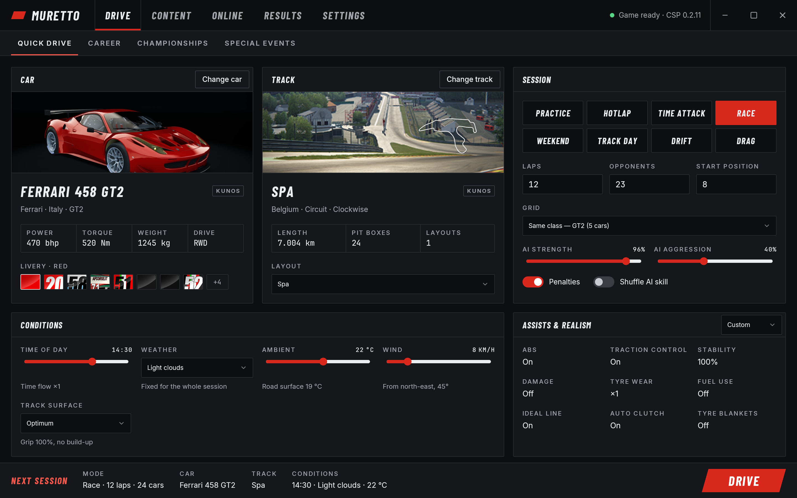
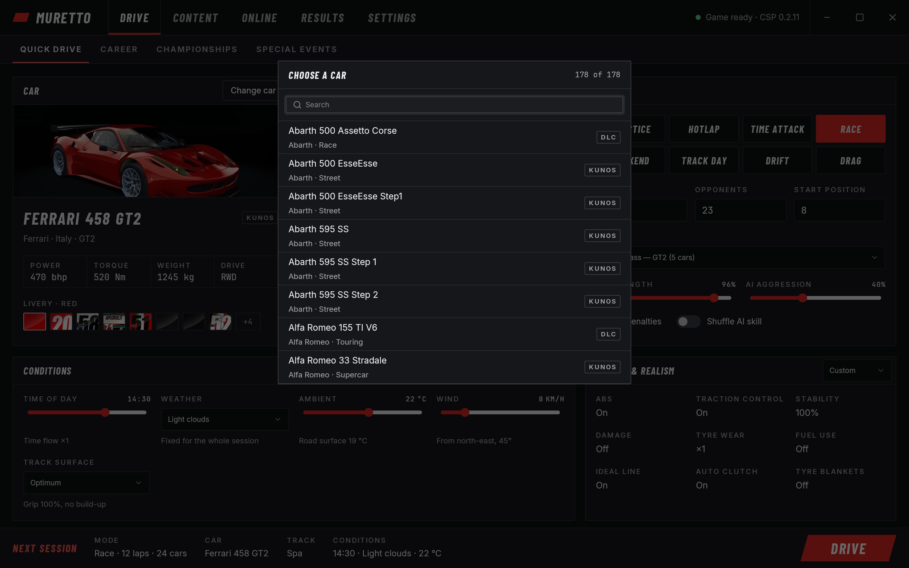
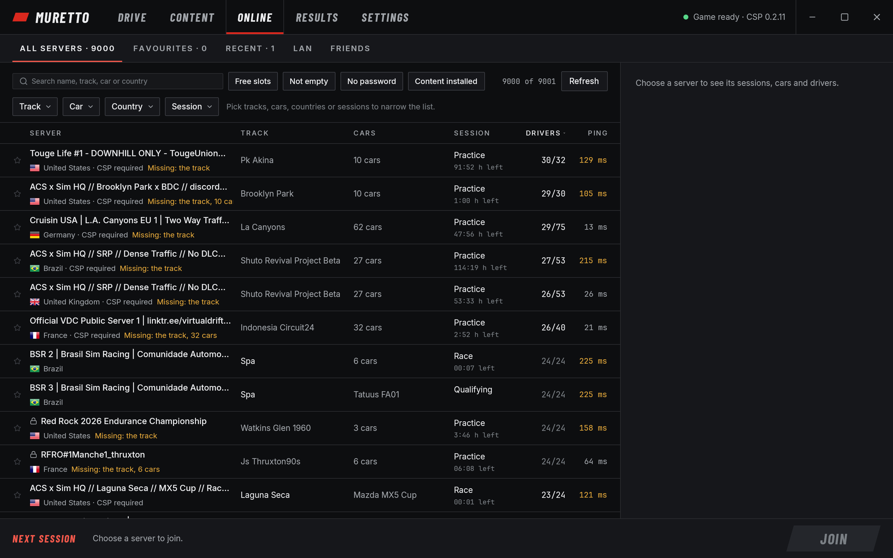
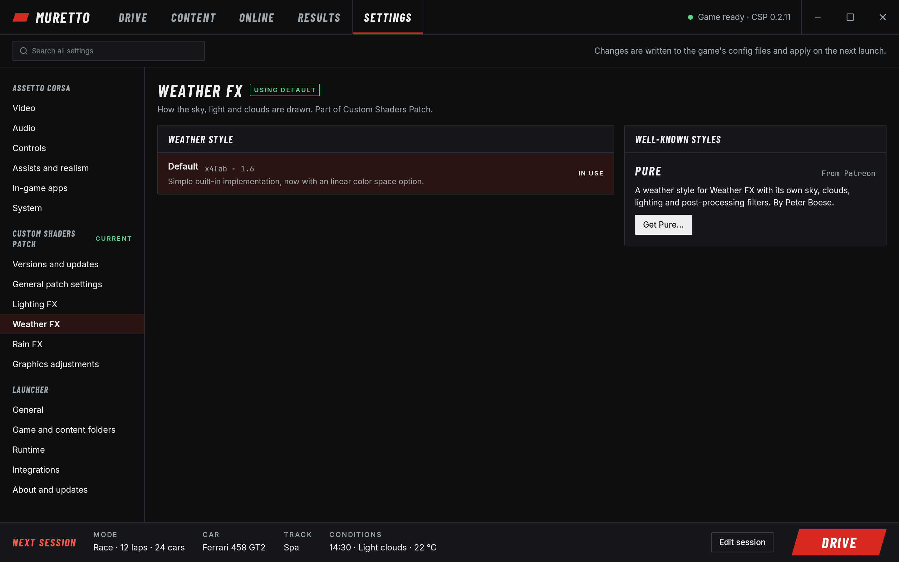

# Muretto

A launcher and content manager for Assetto Corsa, for Linux and Windows.
Written in Rust on [GPUI](https://gpui.rs) through [GPUI Kit](https://gpui-kit.com).



| | |
| --- | --- |
|  |  |
|  | |

## Install

Download the binary for your system from
[muretto.8-prime.dev](https://muretto.8-prime.dev) or the
[releases](https://github.com/8-prime/Muretto/releases) and run it:
`muretto-windows-x86_64.exe` on Windows, `muretto-linux-x86_64` on Linux
after `chmod +x muretto-linux-x86_64`. It is a single file with nothing to
install. Muretto finds the game through Steam; on Linux it runs the game
with Proton.

On Arch Linux and its derivatives, install the
[`muretto-bin`](https://aur.archlinux.org/packages/muretto-bin) package from
the AUR:

```sh
paru -S muretto-bin   # or yay -S muretto-bin
```

The interface follows `docs/design/AC Launcher — UI Design.pdf`.

## Layout

| Path | What it is |
| --- | --- |
| `crates/core` | Everything about the game that is not interface: finding the install, reading cars, tracks and weather, writing `race.ini`, starting the simulator, and installing packages such as Custom Shaders Patch. No UI dependencies; compiles in seconds. |
| `crates/dbghelp-shim` | The Proton fix for Custom Shaders Patch: a `dbghelp.dll` that adds the `acs.pdb` symbols Wine's dbghelp leaves out. Built for Windows and checked in at `crates/core/assets/dbghelp.dll`; after changing it, run `cargo make shim` (needs the `x86_64-pc-windows-gnu` target and mingw-w64). |
| `crates/group-protocol` | What Muretto and the group server say to each other, and how the server keeps its rooms. |
| `crates/group-server` | The server friends' groups meet on (see [Groups](#groups)). Not part of the app build. |
| `crates/app` | The window. `theme.rs` holds colours and type, `ui/` the controls, `shell.rs` the frame, `screens/` one file per screen. |

## Running

Common tasks run through [cargo-make](https://github.com/sagiegurari/cargo-make)
(`cargo install cargo-make`); `cargo make --list-all-steps` lists them all.

```sh
cargo make run      # the app
cargo make test     # core logic and simulated-input UI tests
cargo make check    # formatting, clippy, tests and the shim check: run before committing
cargo make scan     # print what was found on this machine
```

The game is located through Steam's library folders. Set `MURETTO_AC_ROOT`
to the game folder to override that.

To compare the interface with the design without opening a window, render it
offscreen to a PNG. Element ids after the path are clicked first:

```sh
cargo make shot drive.png
cargo make shot cars.png change-car
cargo make shot online.png section:2 wait=4000 input-state "type=drift" server:0
```

`wait=<ms>` lets background work such as pings land; `type=<text>` types
into whatever has focus.

## What Muretto writes into the game folder

Installing a package (so far: Custom Shaders Patch and Pure, under Settings) unpacks it
into `.muretto/staging` inside the game folder, checks it, then moves the
files into place. A receipt of every file is kept in `.muretto/packages`, so
an update clears out what the old version left behind and a removal takes
exactly what was added. Game files a mod overwrites are set aside in
`.muretto/backups` and put back when the mod is removed.

Mods Muretto cannot download itself are described by a recipe in
`crates/core/src/packages/recipes.rs`: where the player gets it, how to
recognise its archive, and what using it means. Getting one opens its page in
the browser and a dialog in Muretto that takes the downloaded zip by drop or
file choice. Add a mod by adding a recipe.

Cars and tracks a server needs are installed from the link the server
gives: straight away when it points at a zip or 7z, through the same
drop-or-choose dialog when it points at a page (Google Drive, Mega,
MediaFire). Every car and track found in the archive or folder goes into
`content/`, each with a receipt; content already there is left alone.

Favourite and recently joined servers are kept outside the game folder, in
`servers.json` in Muretto's settings folder (`~/.config/muretto` on Linux).

## Groups

Online's Friends tab shows which server each friend has open, opens the same
one with a click, and can follow a friend so their choice becomes yours.
Someone starts a group and sends its code (six groups of four letters and
digits); everyone who pastes it is in. Codes are kept in `groups.json` in
Muretto's settings folder, and Muretto rejoins them whenever it starts.

Groups meet on a small server that only relays: the room is a hash of the
code, and each member's state (a random install id, the Steam name, and the
`ip:http-port` of the open server) is sealed with a key derived from the code
(ChaCha20-Poly1305), so the server reads neither. Muretto uses the server
named by `MURETTO_GROUP_SERVER`, else `"server"` in `groups.json`, else
`wss://muretto.8-prime.dev` (`group::DEFAULT_SERVER`).

```sh
cargo run -p muretto-group-server                     # ws://127.0.0.1:3100
docker build -f crates/group-server/Dockerfile -t muretto-group-server .
```

`GROUP_ADDR` sets where it listens and `GROUP_MAX_CONNECTIONS` caps
connections (4096). Run it behind TLS that forwards WebSocket upgrades on
`/v1/` and plain requests everywhere else: opened in a browser, the server
shows a page about Muretto with download links
(`crates/group-server/src/landing.html`). Rooms hold 16 members; a member may send 20 messages in a burst and 5
a second after that.

To be a second member without a second machine, join as a pretend friend;
each line typed is a server to have open:

```sh
cargo run -p muretto-core --example group_friend -- ws://127.0.0.1:3100 <code> Alex 10.0.0.1:8081
```

To try an install against the real download without touching the game:

```sh
cargo run -p muretto-core --example csp -- /tmp/fake-game
```

## Releasing

Bump `version` in `Cargo.toml` (it shows under Settings › About and updates),
commit, and push a tag such as `v0.0.2`. The release workflow builds Linux
(on Ubuntu 22.04, so the binary runs on older glibc) and Windows (gpui
compiles its shaders only on a Windows host) and attaches both binaries,
`muretto-linux-x86_64` and `muretto-windows-x86_64.exe`, with their
`SHA256SUMS`, to a draft release. Keep those names: the landing page links
`releases/latest/download/<name>`. Publish the release, then update the AUR package:

```sh
cargo make aur 0.0.2
```

That copies `packaging/aur/muretto-bin/PKGBUILD` into a clone of the AUR
repository under `target/aur`, sets the version, fills in checksums and
`.SRCINFO`, commits and pushes. It needs `pacman-contrib` (for
`updpkgsums`) and an AUR account with your SSH key.

## Fonts and icons

Barlow Condensed, Inter and JetBrains Mono (SIL Open Font License) and a few
Lucide icons (ISC) are compiled in from `crates/app/assets`, with their
licences beside them.

## License

Muretto is under the [MIT License](LICENSE).
